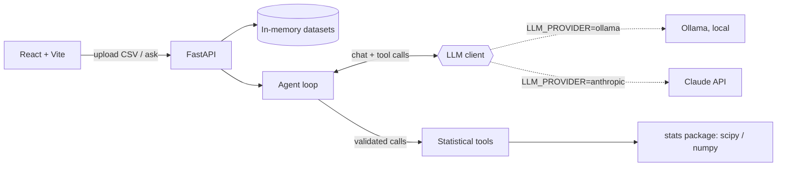

# LLM Stats Analyst

Upload a CSV, ask a question in plain language, and an AI agent chooses, runs and explains the
right statistical test. The LLM plans and explains; **every number comes from tested,
deterministic Python code**, never from the model.


> *"Did the new checkout increase conversion?"* → the agent profiles the data, runs a
> two-proportion z-test, reports the lift with a confidence interval and effect size, and
> flags the caveats.

## Why this project

Most "chat with your data" demos let the model write and run arbitrary pandas code, or worse,
estimate numbers in its head. This project takes the opposite approach:

- **Tools, not free-form code.** The agent can only call a fixed set of statistical tools with
  JSON-Schema-validated arguments. Bad arguments come back as errors the agent can fix.
- **Assumption-aware.** `compare_means` checks normality and sample size and falls back to
  Mann-Whitney U; the prompt asks the agent to confirm doubtful results with a bootstrap.
- **Effect sizes and intervals, not just p-values.** Every result carries Cohen's d / h,
  Cramér's V, rank-biserial or lift, plus confidence intervals and warnings.
- **Provider-agnostic.** Runs fully local and free with [Ollama](https://ollama.com), or with the
  Claude API by changing one environment variable.

## Architecture



| Layer | Path | Responsibility |
| --- | --- | --- |
| Statistics | `backend/src/stats_analyst/stats` | Pure functions returning a `TestResult`. No LLM or web code. |
| Tools | `backend/src/stats_analyst/agent/tools.py` | JSON schemas + argument checks wrapping the statistics. |
| Agent | `backend/src/stats_analyst/agent/analyst.py` | Plan → call tools → feed results back → final answer, with a step limit. |
| LLM | `backend/src/stats_analyst/llm` | Provider-neutral `LLMClient` protocol, Ollama and Claude adapters. |
| API | `backend/src/stats_analyst/api` | Upload, profile and analyze endpoints. |
| UI | `frontend/src` | Upload, data preview, questions, answer and an inspectable tool trace. |

### Available tools

| Tool | Use case |
| --- | --- |
| `describe_dataset`, `describe_column` | Column types, missing values, levels, quantiles, skewness, IQR outliers |
| `compare_means` | Two groups, numeric outcome: Welch's t-test or Mann-Whitney U (auto-selected) |
| `compare_many_groups` | 3+ groups: one-way ANOVA with Levene check, plus Kruskal-Wallis |
| `ab_test_proportions` | Binary outcome A/B test: two-proportion z-test, absolute/relative lift, CI |
| `bootstrap_difference` | Skewed data: bootstrap CI for mean/median difference + permutation p-value |
| `chi_square_independence` | Two categorical columns, with Cramér's V |
| `correlation` | Pearson or Spearman, with CI |

## Quick start

Requirements: Python 3.12+, [uv](https://docs.astral.sh/uv/), Node 22+, and either Ollama or a
Claude API key.

```bash
git clone https://github.com/Milwer7/llm-stats-analyst.git
cd llm-stats-analyst
make install
cp backend/.env.example backend/.env
```

### Option A: free and local with Ollama (default)

```bash
ollama pull qwen2.5:7b        # any model with tool calling works: llama3.1, mistral-nemo, ...
make dev-backend              # http://localhost:8000/docs
make dev-frontend             # http://localhost:5173
```

### Option B: Claude API

In `backend/.env`:

```env
LLM_PROVIDER=anthropic
ANTHROPIC_API_KEY=sk-ant-...
ANTHROPIC_MODEL=claude-haiku-5-5
ANTHROPIC_EFFORT=low
```

Haiku with low effort and prompt caching keeps a typical analysis (4 to 6 model turns) well
under one US cent. Switch `ANTHROPIC_MODEL` to a larger model when you want better reasoning.

### Option C: Docker

```bash
make up            # uses Ollama running on your host
make up-ollama     # also starts Ollama in a container (then: docker compose exec ollama ollama pull qwen2.5:7b)
```

The UI is served at http://localhost:8080.

Then upload `data/samples/checkout_experiment.csv`, a synthetic randomized checkout experiment
(regenerate it with `make sample-data`), and try the suggested questions.

## Configuration

All settings are environment variables (or `backend/.env`).

| Variable | Default | Description |
| --- | --- | --- |
| `LLM_PROVIDER` | `ollama` | `ollama` or `anthropic` |
| `OLLAMA_HOST` | `http://localhost:11434` | Ollama server URL |
| `OLLAMA_MODEL` | `qwen2.5:7b` | Must support tool calling |
| `ANTHROPIC_API_KEY` | | Required when `LLM_PROVIDER=anthropic` |
| `ANTHROPIC_MODEL` | `claude-haiku-5-5` | Claude model ID |
| `ANTHROPIC_EFFORT` | `low` | `low`, `medium` or `high` |
| `AGENT_MAX_STEPS` | `8` | Max model turns per question |
| `LLM_MAX_TOKENS` | `4096` | Max output tokens per turn |
| `MAX_UPLOAD_MB` | `10` | Upload size limit |

## API

| Method | Path | Description |
| --- | --- | --- |
| `GET` | `/api/health` | Status and active provider/model |
| `POST` | `/api/datasets` | Upload a CSV (multipart `file`); returns id, profile and preview |
| `GET` | `/api/datasets/{id}` | Profile and preview of an uploaded dataset |
| `POST` | `/api/datasets/{id}/analyze` | `{"question": "..."}` → answer, tool trace, tokens, latency |

Interactive docs at http://localhost:8000/docs.

## Development

```bash
make test     # pytest: statistics checked against scipy, agent loop with a scripted fake LLM, API
make lint     # ruff, mypy --strict, oxlint
make check    # everything above + frontend build
```

The agent is tested with a scripted fake LLM, so the test suite needs neither Ollama nor an API
key and runs in a few seconds.

## Roadmap

- [ ] Evaluation set of questions with expected test choices, scored per provider
- [ ] Power analysis and sample-size calculator tool
- [ ] Multiple-testing correction when the agent runs several tests
- [ ] Streaming the agent trace to the UI
- [ ] Persistent dataset storage

## Background

Built as a portfolio project applying ideas from *AI-Assisted Statistics for Data Scientists*
(LLMs as a planning and explanation layer over sound statistical procedures) and *Clean Code*
(small pure functions, clear boundaries, tests first-class).

## License

MIT
